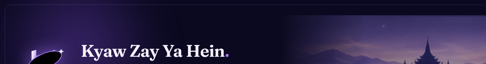

# Kyaw Zay Ya Hein — GitHub Profile Branding & Setup Guide

This guide details how to integrate your approved **KZYH Personal Brand** across your GitHub profile (`@KyawZayYaHein`), repository READMEs, and developer social touchpoints.

---

## 1. Brand Identity Overview

- **Monogram Symbol**: Geometric KZ Monogram crossed by an orbital exploration ring and cosmic star sparkle.
- **Brand Personality**: Mysterious · Futuristic · Culturally Rooted · Elegant.
- **Brand Positioning**: Product Builder · Experimental Engineer · Professional Software Engineer.
- **Brand Taglines**:
  - *"Build Better. Dream Bigger."*
  - *"Building ideas, shaping tomorrow."*
- **Primary Color Palette**:
  - `Midnight Navy / Ink`: `#0B0920`
  - `Deep Violet`: `#17132F`
  - `Accent Violet`: `#7447C8`
  - `Radiant Lavender`: `#A879FF`
  - `Luminous Lilac`: `#DCC5FF`
  - `Soft Paper White`: `#F7F2FF`

---

## 2. GitHub Profile Avatar Setup

### Avatar Asset:
- File: [`kzyh-github-avatar-500.png`](file:///D:/Portfolio%20CV%20Resume/github_branding/kzyh-github-avatar-500.png)
- Resolution: `500 × 500 px` (High DPI circular asset).
- Visual Treatment: Deep midnight navy circular canvas (`#0B0920`) with a luminous cosmic violet outer rim glow (`#7447C8` → `#A879FF`) and the centered radiant KZ monogram with star sparkle.

### Steps to Apply:
1. Navigate to **GitHub Settings** → **Public Profile**: `https://github.com/settings/profile`
2. Click **Edit** on your profile picture.
3. Upload `kzyh-github-avatar-500.png`.
4. Center and save. Because GitHub automatically masks profile pictures into a circle, the calibrated outer rim aligns perfectly with GitHub's circular avatar viewport.

---

## 3. GitHub Profile Header Banner Setup

### Banner Assets:
1. **GitHub Profile README Banner (1280 × 320)**:
   - File: [`kzyh-github-banner-1280x320.png`](file:///D:/Portfolio%20CV%20Resume/github_branding/kzyh-github-banner-1280x320.png)
   - Ideal aspect ratio (4:1) for embedding directly at the top of your GitHub Profile README repository (`KyawZayYaHein/KyawZayYaHein`).
2. **Standard Landscape Banner (1500 × 500)**:
   - File: [`kzyh-github-banner-1500x500.png`](file:///D:/Portfolio%20CV%20Resume/github_branding/kzyh-github-banner-1500x500.png)
   - Standard 3:1 banner format for Twitter/X, LinkedIn background, or GitHub Organization headers.

### Steps to Embed in Profile README:
In your `KyawZayYaHein/README.md`, place this at the very top:

```markdown
<div align="center">
  <a href="https://kyawzayyahein.github.io/portfolio/">
    
  </a>
</div>
```

---

## 4. GitHub Bio & Tagline Recommendations

- **Name**: `Kyaw Zay Ya Hein`
- **Pronouns**: `he/him` (optional)
- **Bio**:
  > Product Builder & Software Engineer | C# .NET · Flutter · Web Systems | MIIT CSE (Expected 2027) | Build Better. Dream Bigger.
- **Location**: `Mandalay, Myanmar`
- **Website**: `https://kyawzayyahein.github.io/portfolio/`
- **Social Accounts**:
  - LinkedIn: `https://linkedin.com/in/kyaw-zay-ya-hein-00aba927b`
  - Portfolio: `https://kyawzayyahein.github.io/portfolio/`

---

## 5. Repository Assets Checklist

| Asset | Path | Usage |
| :--- | :--- | :--- |
| **GitHub Avatar (PNG)** | `D:\Portfolio CV Resume\github_branding\kzyh-github-avatar-500.png` | GitHub Profile Picture |
| **GitHub Avatar (SVG)** | `D:\Portfolio CV Resume\github_branding\kzyh-github-avatar.svg` | Scalable Vector Master |
| **Profile Banner 1280x320** | `D:\Portfolio CV Resume\github_branding\kzyh-github-banner-1280x320.png` | GitHub README Header |
| **Profile Banner 1500x500** | `D:\Portfolio CV Resume\github_branding\kzyh-github-banner-1500x500.png` | LinkedIn / Social Banner |
| **Favicon SVG** | `D:\Project\Project\portfolio\assets\branding\favicon.svg` | Modern browser SVG favicon |
| **Favicon ICO** | `D:\Project\Project\portfolio\favicon.ico` | Multi-res legacy ICO (16/32/48) |
| **Social Card (OG)** | `D:\Project\Project\portfolio\assets\og_card.jpg` | 1200x630 OpenGraph / Twitter |
| **Brand Tokens** | `D:\Project\Project\portfolio\styles.css` | Embedded CSS Design Tokens |
